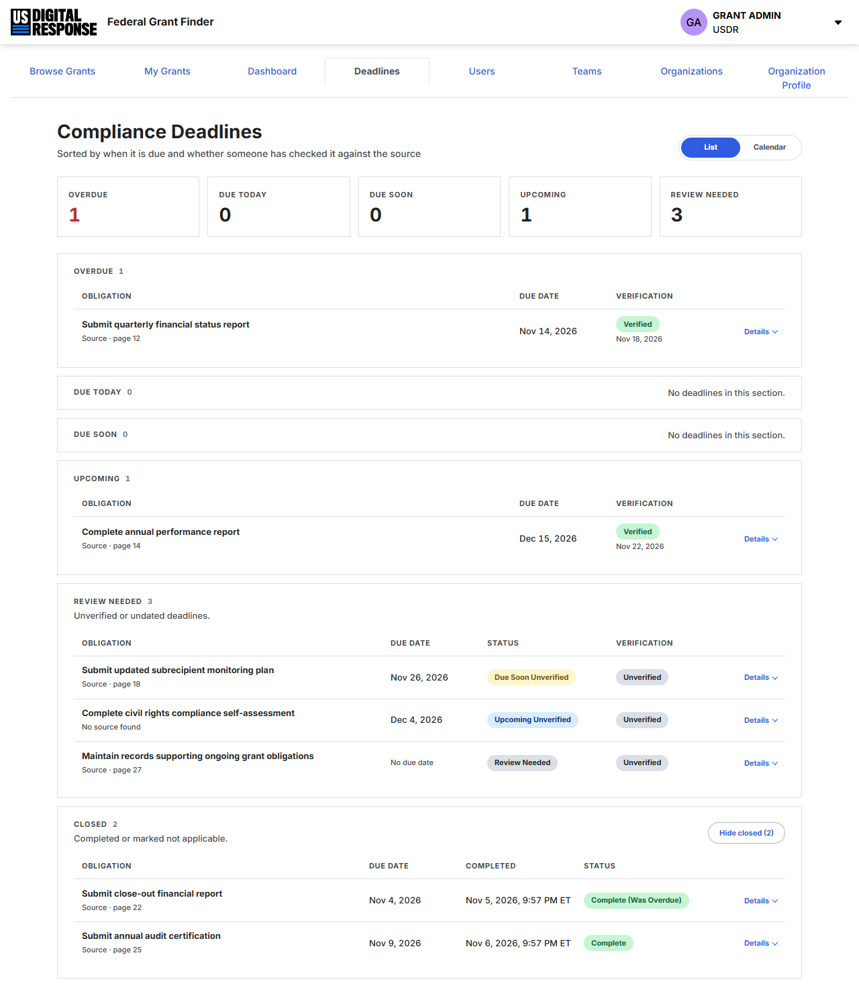
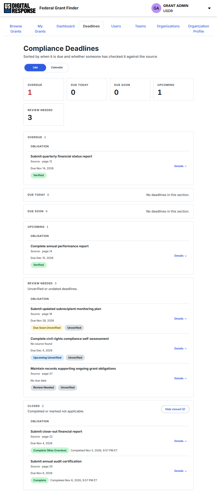
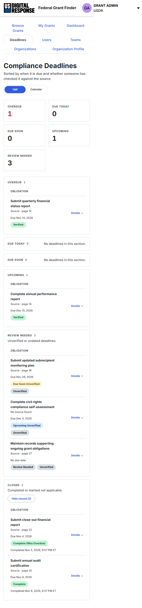
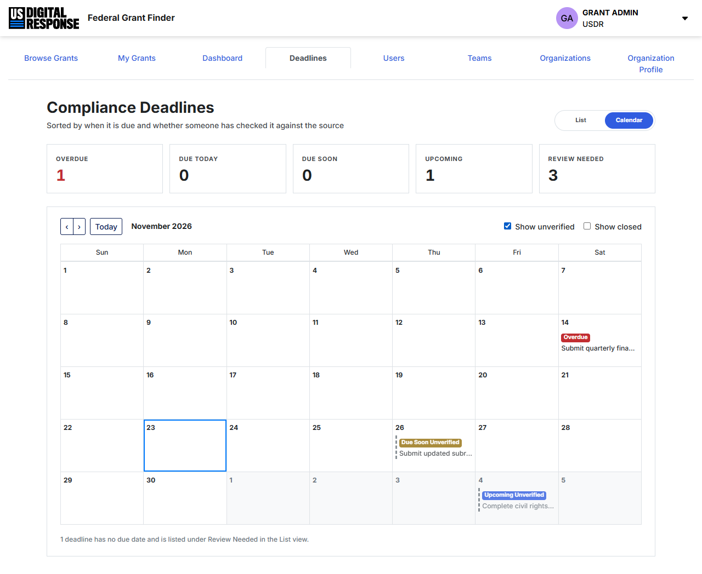
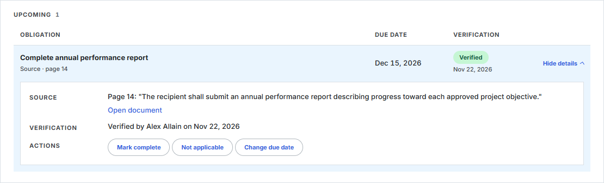
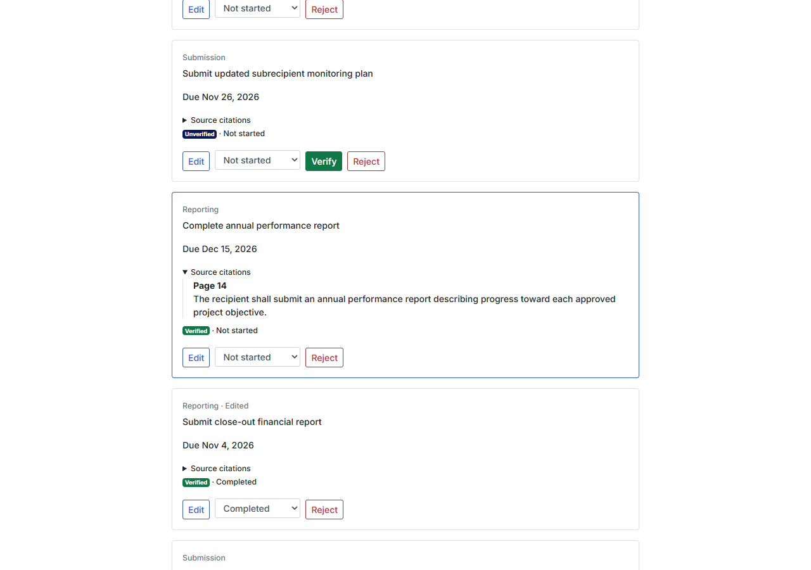

# M-14: Finalize tracker documentation and demo evidence

Manuel Capiendo, November 23, 2026

## What this is

The final package for the Portfolio and Deadline Tracker (F5, section 6.4): where its documentation lives, the proof that it works, and a repeatable demo. How the tracker works is explained in `docs/g32-doc05-portfolio-and-deadline-tracker.md` (DOC-05); this page is the evidence behind it.

## The pieces and where they live

| Piece | Location |
| --- | --- |
| How the tracker works (DOC-05) | `docs/g32-doc05-portfolio-and-deadline-tracker.md` |
| Usability test kit and results (T-10) | `docs/g32-t10-profile-to-deadline-usability-test.md` |
| Test results tied to a commit | `docs/evidence/tracker/test-results.md` |
| List, summary, and calendar cross-check (T-08) | `docs/evidence/tracker/consistency-crosscheck.md` |
| Screenshots | `docs/evidence/tracker/*.png` |
| Date, time zone, and boundary tests (M-13) | `packages/server/__tests__/lib/deadlineStatus.test.js`, `packages/client/src/helpers/dates.spec.js`, `packages/client/src/helpers/deadlineStatus.spec.js`, `packages/client/src/components/ComplianceDeadlinesCalendar.spec.js` |
| Consistency tests (T-08, M-12) | `packages/client/src/views/ComplianceDeadlinesConsistency.spec.js`, `packages/server/__tests__/api/complianceDeadlines.test.js` |
| API contract | `docs/g32-shared-api-contracts.md`, Deadline Contract section |

## How to verify it

From a fresh checkout of `develop` with the containers running (setup in DOC-05, "Before you start"):

1. Server date rules: `docker exec gost-app sh -lc 'cd /app/packages/server && NODE_ENV=test npx mocha __tests__/lib/deadlineStatus.test.js'` (32 passing).
2. Deadline API: `docker exec gost-app sh -lc 'cd /app/packages/server && NODE_ENV=test SUPPRESS_EMAIL=true npx mocha --exit --require __tests__/api/fixtures.js __tests__/api/complianceDeadlines.test.js'` (68 passing).
3. Client, including the consistency tests: `docker exec gost-frontend sh -lc 'cd /app/packages/client && npx vitest run'` (516 passing, 9 skipped).
4. Client under another time zone: the same command with `docker exec -e TZ=Pacific/Auckland ...` (same result).
5. Follow the demo script below against `yarn db:seed` sample data.

## Fixed while finishing the tracker

| Problem | Found by | Fix |
| --- | --- | --- |
| Verified and completed times followed the viewer's own time zone, so a viewer outside Eastern Time could see a verified date one day off, or a completion date that disagreed with "Complete (Was Overdue)" | M-13 tests run with the browser in Pacific/Auckland | Both are shown in Eastern Time, times marked `ET` (M-13 commit) |
| The verifier was shown only as a user number | M-11 review | "Verified by [name] on [date]" (M-11) |
| No way back from a deadline to its source | M-11 review | **Open document** jumps to the checklist item and opens its sources (M-11) |
| Marking an item complete again re-stamped its completion time | M-11 review | Original completion time is kept (M-11) |
| Bad dates, filters, or IDs caused server errors | M-11 review | Clear `400 VALIDATION_ERROR` responses (M-11) |
| Labels lost and text squeezed on phones and tablets | Review of PR #50 | Labels move under each obligation up to 991 px; opening details no longer squeezes the list (#50) |

## Evidence

### Automated tests

All results, with every date case and consistency case listed by name: `docs/evidence/tracker/test-results.md`. In short, on commit `045dee96`: 32 server date tests (also under UTC and Asia/Tokyo), 68 deadline API tests, and 516 client tests under America/New_York, Pacific/Auckland, and America/Los_Angeles, all passing.

The consistency tests were checked against a deliberately broken calendar (closed deadlines shown by default): two of them failed as expected, then passed again once the calendar was restored.

### Cross-check on the running app

`docs/evidence/tracker/consistency-crosscheck.md`: all seven sample deadlines appear in the right list section with the right label and on the right calendar day, the undated deadline stays off the calendar, and every summary card equals its list section.

### Screenshots

| Screen | File |
| --- | --- |
| Deadline list, desktop |  |
| Deadline list, tablet (compact layout) |  |
| Deadline list, phone |  |
| Calendar with unverified deadlines shown |  |
| Details panel |  |
| Open document lands on the checklist item |  |

These show the current UI. They will be retaken after next week's UI pass.

### Usability (T-10)

The test kit is ready: tasks, success criteria, reset steps, observation sheet, questionnaire, and results tables are in `docs/g32-t10-profile-to-deadline-usability-test.md`, along with a facilitator dry run. The sessions run on the team server with real participants; their results are recorded in that file.

## Demo script (5 to 7 minutes)

**Setup, before the demo**

1. `yarn db:seed` the same day, so the sample dates line up: one overdue, one upcoming, two needing review, one undated, and two closed.
2. Sign in as `grant-admin@usdigitalresponse.org` (link from Mailpit at http://localhost:8025).
3. On the team server, use a notice that has already been uploaded and analyzed, so **Verify against source** works.
4. Browser at full width, zoom 125%.

**Walkthrough**

| Time | Show | Say |
| --- | --- | --- |
| 0:00 | Deadlines page, list view | "Every deadline comes from a checklist item the AI found in a grant notice. Nothing is copied into a separate table." |
| 0:45 | Summary cards and sections | "Status is calculated once on the server in Eastern Time, so a deadline turns overdue at midnight Eastern for everyone." |
| 1:30 | Review Needed | "Unverified or undated items stay here, so AI output never counts as a confirmed deadline." |
| 2:15 | **Details** on the upcoming deadline | "Each deadline shows the exact quote and page it came from, and who verified it." |
| 3:00 | **Open document** | "One click goes back to that requirement in the notice, with its source open." |
| 3:45 | Back, then **Mark complete**, then **Show closed** | "Completed work leaves the active list but stays on record." |
| 4:30 | **Change due date** on another deadline | "A changed date goes back to Review Needed until someone confirms it, so a typo can't become a trusted deadline." |
| 5:15 | **Calendar**, then **Show unverified** | "The same deadlines on a month calendar. Our tests check that the list, the counts, and the calendar always agree." |
| 6:00 | Narrow the window below 992 px | "On tablets and phones the labels move under each item instead of being hidden." |

**Reset:** run `yarn db:seed` again.

## Still open

- Usability sessions (T-10) are pending; findings that need visual changes go into next week's UI pass.
- Next week's UI pass covers the calendar and details panel styling; screenshots and the demo recording are retaken afterwards.
- The calendar's details panel does not offer **Verify against source**; only the list view does.
- Changing the due date of a verified item on the checklist page keeps it verified, while the tracker sets it back to unverified. Raised with the checklist owner.
- The due soon window (7 days) and time zone (Eastern) are fixed for every organization.
- Changing a date from the tracker does not detect a simultaneous edit to the same item; the last save wins.
